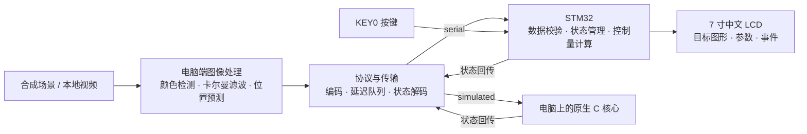

# ActiveVisionTracking

基于 STM32 的视觉目标跟踪与预测系统，用于观察目标在运动、遮挡和通信延迟下的位置变化，并通过开发板上的中文界面展示跟踪结果。

系统由电脑端和 STM32 终端组成：电脑负责处理图像、检测目标和预测位置；STM32 负责接收数据、管理运行状态、响应按键，并在 7 寸屏幕上显示当前坐标、预测坐标和通信状态。水平、垂直控制量以数值和十字标记的形式呈现。

## 功能

### 目标检测与遮挡预测

电脑端支持合成场景和本地视频两种输入。默认检测绿色目标，也可以通过指定图像区域（ROI）采集目标颜色。

- 从图像中提取目标中心，计算位置、速度和置信度。
- 使用卡尔曼滤波平滑位置，并预测目标接下来的运动。
- 目标短时被遮挡时继续预测；持续丢失后将目标标记为无效，重新出现时进行重捕获。
- 在界面上显示检测点、预测点、运动轨迹及跟踪状态。

跟踪状态包括：**正在跟踪、短时遮挡、目标丢失、正在重捕获**。

### 通信延迟与预测效果对比

电脑端可以设置发送延迟、抖动和丢包，比较当前位置直接发送与预测后发送的差别。合成场景提供目标真值，用于计算两种方式的位置误差。

运行窗口显示延迟设置、图像处理耗时、往返时间和补偿前后的平均位置误差。实验过程同时保存为 CSV 和 JSON，便于复盘和比较不同参数。

### STM32 中文交互终端

开发板上电后进入中文主界面，显示：

- 待机、运行或暂停状态，以及运行时间。
- 电脑连接状态、目标状态和最近数据的年龄。
- 当前坐标、预测坐标及水平、垂直控制量。
- 收发包数量、CRC 错误、定时器计数和最近事件。
- 目标示意区中的当前位置与预测位置。

开发板可以独立运行。尚未收到电脑数据时，进入运行状态会显示本地生成的运动轨迹，用于检查屏幕坐标、绘图和刷新效果；收到电脑数据后，显示内容切换为电脑发送的跟踪结果。

| 操作 | 功能 | DS0 状态 |
|---|---|---|
| 短按 KEY0 | 待机 → 运行 → 暂停 → 运行 | 运行时常亮，暂停时闪烁 |
| 长按 KEY0 约 1 秒 | 返回待机 | 熄灭 |
| 按住 KEY0，再按下并释放 RESET | 进入红、绿、蓝、白、黑色块自检，检查文字及四角标记 | — |
| 自检中松开 KEY0 后，再短按一次 | 退出自检，进入主界面 | — |

### 双向通信与状态管理

电脑和 STM32 通过二进制协议交换数据：电脑发送目标位置、预测位置、跟踪状态和数据有效期；STM32 返回运行状态、收包计数及控制量。

协议使用 CRC16 校验，并通过会话号、序列号和有效期处理重复、乱序及过期数据。目标失效、通信超时或设备暂停时，控制量归零。

电脑端提供两个接收后端：

- `serial`：通过串口连接 STM32，观察板上屏幕与电脑窗口的同步变化。
- `simulated`：在电脑上运行原生 C 协议和业务核心，用于自动测试和算法实验。

## 系统架构



STM32 固件按职责分层：

| 模块 | 主要文件 | 职责 |
|---|---|---|
| 应用与调度 | `app.c`、`avt_runtime.c` | 按键事件、状态切换、通信处理和周期任务 |
| 业务核心 | `avt_core.c` | 目标有效期、序列检查、控制量平滑与限幅 |
| 协议 | `avt_protocol.c` | 帧编码、流式拆包、CRC16 和错误恢复 |
| 板级通信与时基 | `board_io.c` | USART1 中断收发、环形缓冲、TIM3 计数 |
| 屏幕驱动 | `lcd_bus.c`、`lcd_panel.c` | FSMC 总线、SSD1963 初始化、图形与文字绘制 |
| 中文界面 | `ui.c`、`font_cn.c` | 页面布局、区域刷新、中文字模和事件显示 |
| 按键与指示灯 | `key.c`、`led.c` | 按键消抖、长短按识别与 LED 控制 |

## 硬件与技术栈

| 部分 | 配置与技术 |
|---|---|
| 开发板 | 正点原子战舰 ATK-DNF103P V4.7，STM32F103ZET6，72 MHz，512 KB Flash、64 KB RAM |
| 显示屏 | ATK-MD0700 V2.4，SSD1963，800 × 480，RGB565，FSMC 16 位并口 |
| 交互 | KEY0（PE4）、DS0（PB5），20 ms 按键消抖、1 秒长按 |
| 固件 | C11、STM32CubeMX、STM32 HAL、CMSIS、裸机非阻塞任务调度 |
| 时基与通信 | SysTick 毫秒时基、TIM3 100 Hz 中断计数、USART1 115200 / 8N1、中断环形缓冲 |
| 构建与调试 | ARM GNU Toolchain、CMake、Ninja、VS Code、ST-LINK / SWD |
| 电脑端 | Python、OpenCV、NumPy、Pillow、pyserial |
| 算法 | HSV 颜色分割、连通域检测、常速度卡尔曼滤波、短时运动预测 |
| 测试与记录 | pytest、原生 GCC、ctypes、CSV、JSON |

屏幕利用 SSD1963 自带显存，通过局部刷新更新内容；中文以精简点阵字库存放在 Flash 中。

## 快速开始

在 PowerShell 中进入工程目录：

```powershell
cd D:\STM32Projects\ActiveVisionTracking
```

### 配置电脑端环境

项目使用独立 Python 虚拟环境。已有 `.venv` 时可以直接运行；首次配置执行：

```powershell
powershell -ExecutionPolicy Bypass -File tools\setup_host.ps1
```

需要 Python 3.11 或更新版本，以及用于编译电脑端 C 核心的 GCC。依赖列表位于 `host/requirements.txt` 和 `tests/requirements.txt`。

### 运行跟踪演示

```powershell
.\.venv\Scripts\python.exe -m host --frames 1800 --output runs\demo
```

默认合成场景包含目标运动、部分遮挡、完全遮挡和重新出现。白圈表示目标真值，黄圈表示图像检测位置，青圈表示发送的预测位置。

| 按键 | 功能 |
|---|---|
| `P` | 开启或关闭时延补偿 |
| `Q` / `Esc` | 退出 |
| `R` | 串口模式下重新连接 |

可以调整延迟、抖动和丢包概率：

```powershell
.\.venv\Scripts\python.exe -m host --delay-ms 120 --jitter-ms 20 --loss 0.03
```

### 处理本地视频

将视频路径替换为自己的文件：

```powershell
.\.venv\Scripts\python.exe -m host --video "D:\Videos\target.mp4" --output runs\video
```

默认寻找绿色目标。也可通过 `--roi X Y W H` 指定第一帧中的目标区域，用该区域采集目标颜色：

```powershell
.\.venv\Scripts\python.exe -m host --video "D:\Videos\target.mp4" --roi 120 80 80 60
```

### 连接开发板

使用开发板的 USB 串口接口连接电脑，查看可用端口：

```powershell
.\.venv\Scripts\python.exe -m host --list-ports
```

将下方 `COM8` 替换为对应端口：

```powershell
.\.venv\Scripts\python.exe -m host --backend serial --port COM8 --frames 1800 --output runs\serial
```

短按板上 KEY0 进入运行状态，LCD 将显示收到的目标位置和跟踪状态，电脑窗口显示 STM32 的回传数据。窗口中的后端名称表示当前使用串口还是主机测试后端；串口打开失败或断开时，程序会提示并切换后端。

接线说明见 [硬件连接](docs/HARDWARE_WIRING.md)。

### 构建固件

```powershell
powershell -ExecutionPolicy Bypass -File tools\build.ps1 -Config Debug
```

构建结果位于 `build/Debug/`，包括 `ActiveVisionTracking.elf`、`.bin`、`.hex` 和 `.map`。构建及烧录步骤见 [构建与烧录](docs/BUILD_AND_FLASH.md)。

## 实验输出与测试

每次电脑端运行会在 `--output` 指定的目录中生成：

| 文件 | 内容 |
|---|---|
| `trace.csv` | 各帧坐标、速度、置信度、预测位置、时延及设备回传数据 |
| `summary.json` | 跟踪状态统计、位置误差和处理耗时汇总 |
| `preview.png` | 运行界面截图 |
| `occlusion.png` | 运行到第 101 帧时保存的界面截图 |

不打开图形窗口运行：

```powershell
.\.venv\Scripts\python.exe -m host --headless --frames 600 --output runs\headless
```

运行自动测试：

```powershell
.\.venv\Scripts\python.exe -m pytest tests -q
```

测试覆盖 C / Python 协议一致性、分包与错帧恢复、序列号与超时处理、按键状态机、遮挡恢复、时延补偿以及 C 界面绘制。

## 目录结构

```text
ActiveVisionTracking/
├── Core/                     # 启动入口、中断框架、时钟与系统代码
├── Drivers/                  # STM32 HAL 与 CMSIS
├── User/
│   ├── Inc/                  # 固件模块接口
│   └── Src/                  # 应用、协议、板级驱动、LCD 与中文界面
├── host/                     # Python 跟踪算法、传输后端和运行入口
├── tests/                    # 协议、业务、视觉与界面测试
├── tools/                    # 构建、环境配置、字模生成和工程检查脚本
├── docs/                     # 接线、屏幕、协议和操作文档
├── cmake/                    # ARM 工具链与 CubeMX 构建配置
├── ActiveVisionTracking.ioc  # CubeMX 工程配置
├── CMakeLists.txt
└── CMakePresets.json
```

## 相关文档

- [硬件连接](docs/HARDWARE_WIRING.md)：LCD、供电、ST-LINK 和板载 USB 串口。
- [构建与烧录](docs/BUILD_AND_FLASH.md)：固件构建、调试入口和 CubeMX 配置维护。
- [屏幕驱动](docs/LCD_INTEGRATION.md)：接口、引脚、显示时序和自检方法。
- [通信协议](docs/PROTOCOL.md)：消息格式、字段、校验和状态返回。
- [演示操作](docs/DEMO_GUIDE.md)：独立运行、电脑端运行和串口联动步骤。
